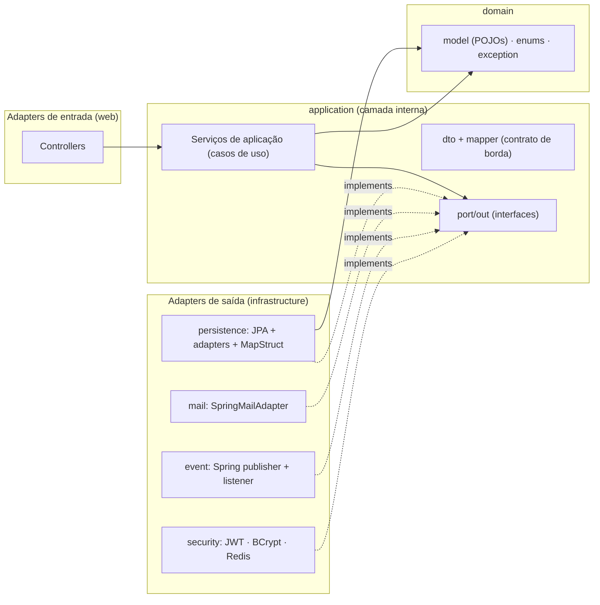
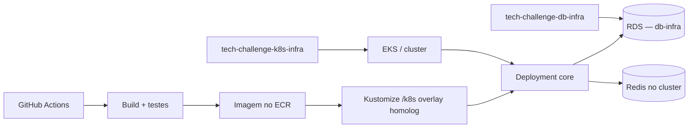
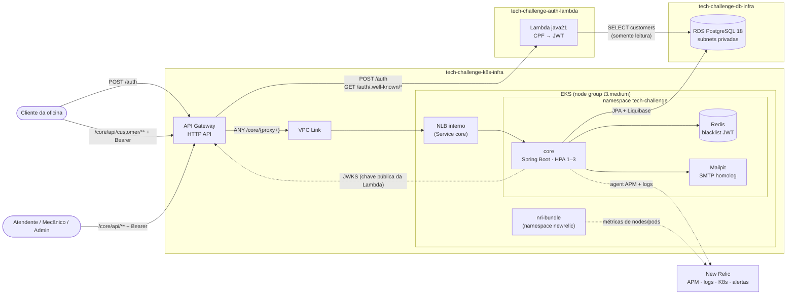
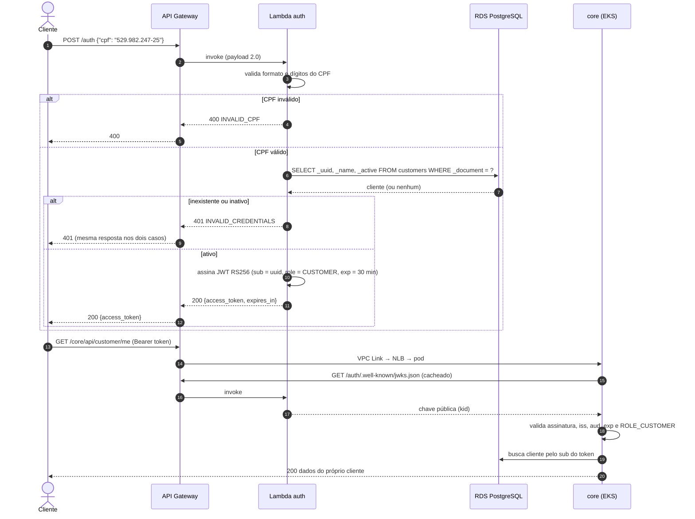
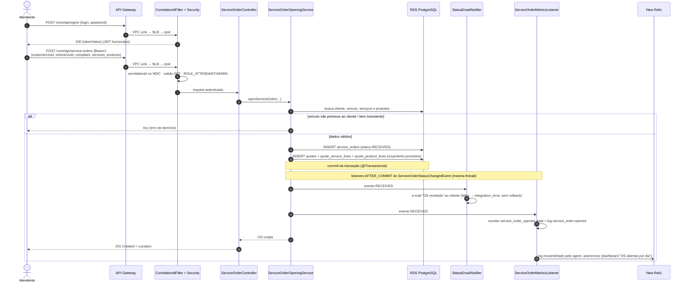
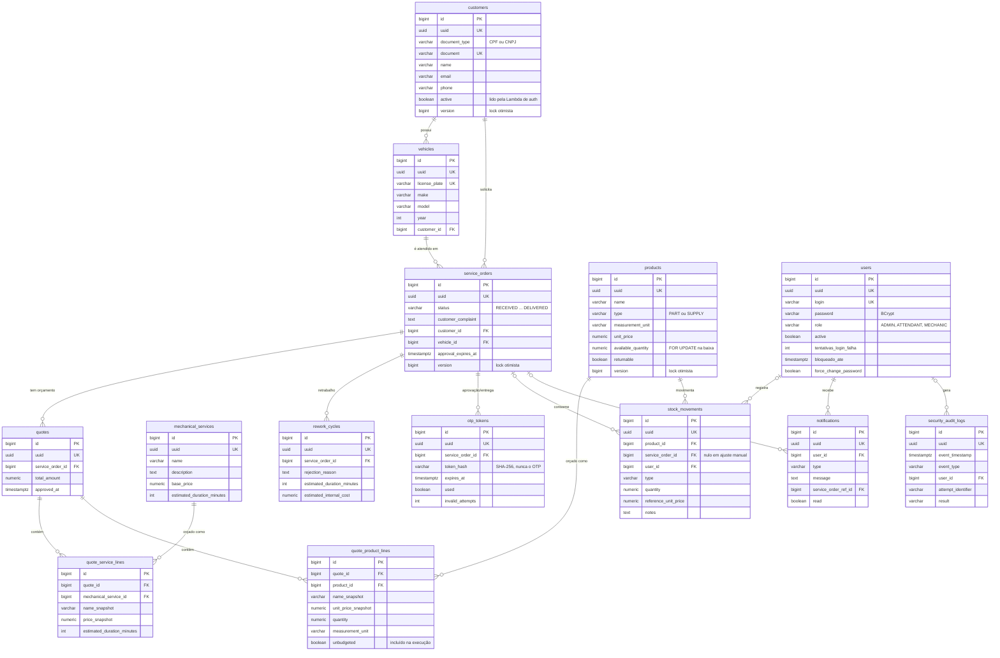

# The Java Garage — Sistema de Atendimento e Execução de Serviços

> **Tech Challenge — Fase 3 | Pós Tech FIAP 15SOAT**  
> Aplicação principal (`tech-challenge-core`). As Fases 1 e 2 ficam aqui; na Fase 3 o deploy sobe para EKS, com banco e cluster nos repositórios de infra.

Back-end de oficina mecânica: ordens de serviço, clientes e estoque. Domínio em DDD, organização em arquitetura hexagonal, com testes, segurança JWT, Kubernetes (Kustomize) e CI/CD.

### Repositórios do grupo

| Repo | Papel |
|---|---|
| [tech-challenge-core](https://github.com/fiap-pos-2026/tech-challenge-core) | App + Kustomize + pipeline de deploy |
| [tech-challenge-auth-lambda](https://github.com/fiap-pos-2026/tech-challenge-auth-lambda) | Lambda de login por CPF → JWT |
| [tech-challenge-db-infra](https://github.com/fiap-pos-2026/tech-challenge-db-infra) | Terraform do RDS PostgreSQL |
| [tech-challenge-k8s-infra](https://github.com/fiap-pos-2026/tech-challenge-k8s-infra) | Terraform do EKS e API Gateway |

---

## Contexto e Proposta

Uma oficina mecânica de médio porte utilizava anotações manuais e planilhas para gerenciar atendimentos, diagnósticos, execução e entrega de veículos. Isso gerava erros na priorização dos atendimentos, falhas no controle de peças, dificuldade de acompanhar status dos serviços, perda de histórico de clientes e ineficiência no fluxo de orçamentos e autorizações.

O sistema resolve esses problemas permitindo:

- Acompanhar o andamento da OS em tempo real via API (sem necessidade de login)
- Receber e-mail a cada mudança de status da OS
- Autorizar ou rejeitar orçamentos diretamente pelo cliente via link/OTP
- Controlar estoque de peças e insumos com auditoria por movimentação
- Gerenciar toda a operação interna com autenticação JWT por papel (Mecânico / Atendente)

### Objetivos da Fase 2

A Fase 2 evolui o back-end da Fase 1 para atender qualidade, resiliência e escalabilidade:

- **Migração para Arquitetura Hexagonal (Ports & Adapters)**: domínio livre de framework
  (POJOs sem JPA/Hibernate/Bean Validation), persistência e I/O atrás de _ports_ com _adapters_
  em `infrastructure/`
- Abertura de OS com serviços e peças opcionais já no ato do cadastro
- Listagem priorizada de OS (ordem de negócio + exclusão de Finalizada/Entregue por padrão)
- Notificação do cliente por e-mail a cada mudança de status da OS
- Deploy da aplicação via **Kustomize** (`/k8s`), com HPA, ConfigMaps e Secrets
- **Pipeline CI/CD** (GitHub Actions): build, testes, publicação da imagem e deploy Kustomize
- Cluster (EKS) e banco gerenciado (RDS) vivem nos repositórios irmãos `tech-challenge-k8s-infra`
  e `tech-challenge-db-infra` — não neste repo

---

## Domínio (DDD)

### Bounded Contexts

```
┌──────────────────────────────────┐   ┌────────────────────────────────┐
│   Attendance (Core Domain)       │   │   Inventory (Supporting)       │
│                                  │   │                                │
│  Aggregate: ServiceOrder         │◄──│  Aggregate: Product            │
│  Aggregate: Customer             │   │  Entity:    StockMovement      │
│  Aggregate: Vehicle              │   └────────────────────────────────┘
│  Aggregate: MechanicalService    │
│  Entity:    Quote                │
└──────────────────────────────────┘
          ▲
          │ (Auth via JWT)
┌─────────┴────────────────────────┐
│   Identity (Generic Domain)      │
│   JWT Authentication             │
└──────────────────────────────────┘
```

- **Attendance** — contexto central; controla o ciclo de vida completo da Ordem de Serviço.
- **Inventory** — suporte; gerencia produtos, quantidades e movimentações de estoque.
- **Identity** — genérico; provê autenticação JWT sem lógica de negócio.

### Ciclo de Vida da Ordem de Serviço

```
RECEIVED → IN_DIAGNOSIS → AWAITING_APPROVAL → IN_PROGRESS → COMPLETED → DELIVERED
                                                   │
                                                   ├──► AWAITING_APPROVAL  (produto não orçado adicionado em execução)
                                                   ├──► CANCELLED          (orçamento expirado após 7 dias ou rejeitado)
                                                   └──► DISPUTED           (rejeição persistente na vistoria de entrega)
```

A cada transição de status persistida com sucesso (inclusive a abertura, que "transiciona" para
`RECEIVED`), o cliente recebe um e-mail com o identificador da OS e o novo status. Falha de SMTP é
registrada em log e **não** reverte a transição já persistida.

### Linguagem Ubíqua

| Termo | Definição |
|---|---|
| **Ordem de Serviço (OS)** | Registro central do atendimento; agrega serviços, produtos, orçamento e status. |
| **Orçamento** | Composição de valores gerada automaticamente após o diagnóstico (ou já na abertura, se houver itens). |
| **Aprovação de Orçamento** | Ação do Cliente autorizando a execução via OTP, sem necessidade de conta. |
| **Produto** | Termo guarda-chuva para Peças e Insumos controlados no estoque. |
| **Atendente** | Colaborador responsável pelo cadastro e acompanhamento administrativo da OS. |
| **Mecânico / Técnico** | Colaborador responsável pelo diagnóstico e execução dos serviços. |

---

## Stack

| Camada | Tecnologia |
|---|---|
| Linguagem | Java 25 |
| Framework | Spring Boot 4.1.0 |
| Build | Gradle Kotlin DSL |
| Banco de dados | PostgreSQL 18.4 |
| Cache / Rate limiting | Redis 7 |
| Migrations | Liquibase |
| Segurança | Spring Security + JWT RSA (OAuth2 Resource Server) |
| Documentação | Springdoc OpenAPI 3 (Swagger UI) |
| Mapeamento | MapStruct (DTO ↔ domínio, domínio ↔ entidade JPA) |
| Testes de integração | Testcontainers |
| Cobertura | JaCoCo (gate ≥ 80% LINE em `application`, `validation` e `infrastructure.persistence.adapter`) |
| Trava de arquitetura | ArchUnit (`HexagonalArchitectureTest` no `:core:test`) |
| Orquestração | Kubernetes via Kustomize (`/k8s`); cluster EKS em `tech-challenge-k8s-infra` |
| Banco gerenciado | RDS PostgreSQL em `tech-challenge-db-infra` |
| CI/CD | GitHub Actions (build/test/imagem + deploy Kustomize) |

### Arquitetura — Hexagonal (Ports & Adapters)

Back-end monolítico em **Arquitetura Hexagonal**, aplicando a **Regra de Dependência** da Clean
Architecture: as setas apontam sempre para dentro (`web` e `infrastructure` dependem de
`application`, que depende de `domain`; `domain` não depende de ninguém). Na Fase 2 o código da
Fase 1 (em camadas Spring, com o domínio sendo as próprias entidades JPA) foi migrado para este
layout.

```
domain/
  model/          →  Núcleo: entidades e regras invariantes como POJOs — sem jakarta.persistence,
                     sem Hibernate, sem Bean Validation. equals/hashCode por identidade de negócio
  enums/          →  Enums de domínio + EApplicationError (com ErrorStatus próprio, sem HttpStatus)
  exception/      →  Exceções de negócio (sem org.springframework.*)

application/       →  Camada interna: serviços de aplicação (casos de uso, @Service, @Transactional)
  serviceorder/   →  Caso de uso ServiceOrder decomposto por fase: ServiceOrderOpeningService,
                     ServiceOrderDiagnosisService, QuoteApprovalService, ServiceOrderExecutionService,
                     ServiceOrderDeliveryService, ServiceOrderDisputeService, ServiceOrderQueryService,
                     sobre 3 colaboradores package-private (ServiceOrderStore, QuoteWorkbench,
                     ServiceOrderResponseFactory)
  dto/            →  DTOs de request/response (records) — o contrato de borda pertence ao núcleo
  mapper/         →  MapStruct DTO ↔ domínio
  port/out/       →  Portas de saída (interfaces): *Repository, MailPort, PasswordHasher,
                     DomainEventPublisher, TokenBlacklistPort, CurrentActorPort
  event/          →  ServiceOrderStatusChangedEvent (record neutro)
  scheduler/      →  Expiração automática de orçamentos (7 dias)

infrastructure/   →  Adapters de saída (frameworks & drivers)
  persistence/
    entity/       →  Entidades JPA (*Entity) — todo o mapeamento @Entity/@Column/@ManyToOne/@Version
    jpa/          →  Interfaces Spring Data (*JpaRepository)
    adapter/      →  *RepositoryAdapter implements application.port.out.*Repository
    mapper/       →  PersistenceMapper (MapStruct) domínio ↔ *Entity, com tratamento de ciclo
                     no agregado Quote
  security/       →  SecurityConfig, filtros JWT, TokenUtility, TokenMapper, UserDetailsImpl (compõe
                     o domain.model.User, não estende), SpringUserDetailsService (UserDetailsService
                     do Spring, isolado da camada de aplicação), BCryptPasswordHasher,
                     RedisTokenBlacklistService, AdminCredentialInitializer,
                     SecurityContextCurrentActorAdapter
  mail/           →  SpringMailAdapter implements MailPort (envolve JavaMailSender)
  event/          →  SpringDomainEventPublisher; StatusEmailNotifier (@TransactionalEventListener)
  config/         →  MessageSource, OpenAPI, PasswordEncoder

web/              →  Adapters de entrada
  controller/     →  @RestController (só tradução HTTP; delega para os casos de uso)
  dto/            →  PageResponseDTO (envelope de paginação exclusivo da borda web)
  exception/      →  @ControllerAdvice (traduz ErrorStatus → HTTP)

util/  validation/ →  Helpers de borda (Translator, WebUtility, AuthUtility) e validadores
                      (@ValidTaxId CPF/CNPJ, @ValidLicensePlate)
```

A **Regra de Dependência é verificada por teste**: `HexagonalArchitectureTest` (ArchUnit) roda
dentro de `:core:test` e falha o build se `domain` ou `application` (incluindo `application.port`)
passarem a depender de `web` ou `infrastructure`, ou se o `domain` ganhar dependência de
Spring/JPA/MapStruct/Jackson. Exceção única e documentada: `AuthenticationService`, que ainda
importa `infrastructure.security` (Spring Security) — dívida técnica registrada para extração
futura em portas de autenticação/token.



**Gate de cobertura (JaCoCo ≥ 80% LINE)** mede os pacotes `application.*` (casos de uso),
`validation.*` e `infrastructure.persistence.adapter` (os adapters JPA, cobertos pelos testes de
integração). Ficam de fora da métrica: `application.dto`, `application.mapper` (glue MapStruct),
controllers, `config`, `exception`, `enums` e `domain`.

### Arquitetura da infraestrutura (papel deste repo)



Este repositório versiona só a **aplicação** e os manifests **Kustomize**. Cluster e banco
gerenciado são provisionados pelos repos de infra. O Secret da aplicação é criado fora do Git
(CI ou `kubectl`), porque contém senha do banco, SMTP e chaves JWT.

### Visão de componentes na nuvem (Fase 3)

Tudo entra pelo **API Gateway (HTTP API)**. `/auth` vai para a Lambda de login por CPF; `/core` atravessa
um VPC Link até o NLB interno do Service do core no EKS. Lambda e app leem o mesmo RDS, que fica nas
subnets privadas. Cada caixa tracejada indica o repositório que provisiona aquele pedaço.



| Componente | Papel | Provisionado em |
|---|---|---|
| API Gateway HTTP API | Porta de entrada única; roteia `/auth` e `/core` | `tech-challenge-k8s-infra` (rotas `/auth` no `tech-challenge-auth-lambda`) |
| Lambda de autenticação | Valida o CPF, consulta o cliente e assina o JWT `CUSTOMER` | `tech-challenge-auth-lambda` |
| EKS + NLB interno | Executa o core com HPA; o NLB só é alcançável pelo VPC Link | `tech-challenge-k8s-infra` + Service `LoadBalancer` deste repo |
| RDS PostgreSQL | Banco único da oficina (app + leitura de clientes pela Lambda) | `tech-challenge-db-infra` |
| New Relic | APM, logs com `correlationId`, métricas do cluster, dashboards e alertas | agent na imagem + `k8s/observability` |

**Quem valida o token?** O próprio core. Em `AUTH_MODE=BOTH` (padrão), um decoder composto aceita os
dois emissores: o JWT de funcionário (`/api/signin`, chave RSA do core) e o JWT de cliente emitido pela
Lambda (validado por `iss`, `aud` e pela chave pública publicada em `/auth/.well-known/jwks.json`).
As rotas `/api/customer/**` exigem `ROLE_CUSTOMER`; as de staff continuam com `ADMIN`/`ATTENDANT`/`MECHANIC`.

### Sequência — autenticação do cliente por CPF



### Sequência — abertura de Ordem de Serviço

A abertura é feita pelo atendente (ou admin) com o JWT de funcionário. Logo depois do commit, ainda
na mesma requisição, dois listeners reagem ao evento de mudança de status: um envia o e-mail ao
cliente e outro registra métricas e o log `service_order.opened`, que alimenta o dashboard no New Relic.



---

## Pré-requisitos

- **Docker** e **Docker Compose** (recomendado para execução local)
- **JDK 25** e **Gradle** (para execução local sem Docker)
- **kubectl** + cluster acessível (EKS via `tech-challenge-k8s-infra`, ou microk8s local)
- Repositório GitHub com Actions habilitado — para validar o CI/CD
- Para homolog/prod na AWS: outputs do `tech-challenge-db-infra` (endpoint JDBC) e do
  `tech-challenge-k8s-infra` (kubeconfig / EKS)

---

## Como Executar

### Com Docker Compose (recomendado para desenvolvimento)

```bash
docker-compose up --build
```

Isso sobe a aplicação, o PostgreSQL, o Redis e o Mailpit (servidor SMTP local que captura os e-mails
de OTP e de notificação de status em desenvolvimento — acesse `http://localhost:8025`). A aplicação
estará disponível em `http://localhost:8080/core`.

Para parar:

```bash
docker-compose down
```

### Executando localmente (sem Docker)

```bash
# 1. Suba o banco de dados
docker run -d \
  --name tech-pg \
  -e POSTGRES_USER=techdev \
  -e POSTGRES_PASSWORD=techdevpw \
  -e POSTGRES_DB=techbase \
  -p 5432:5432 \
  postgres:18.4-alpine

# 2. Execute a aplicação
./gradlew :core:bootRun
```

A aplicação sobe em `http://localhost:8080/core`.

Swagger UI disponível em: `http://localhost:8080/core/swagger-ui.html`

### Kubernetes (Kustomize)

Manifests em `/k8s`: `base` (Deployment, Service, ConfigMap, Secret de exemplo, HPA) e dois overlays:

- `homolog` — EKS: banco no RDS, Redis e Mailpit no cluster, imagem do ECR. Usado pelo CI.
  Os valores do ambiente (host do RDS, modo de autenticação, issuer/JWKS da Lambda) vêm de
  `k8s/overlays/homolog/runtime.env`, gerado no deploy (modelo em `runtime.env.example`).
- `local` — microk8s: imagem do GHCR, NodePort, requests reduzidos.
- `prod` — **esboço**, ainda sem job no CI: namespace próprio, 2+ réplicas (HPA 2–6), Redis e SMTP
  gerenciados (ElastiCache / provedor de e-mail) informados no `runtime.env` (modelo em `runtime.env.example`).

O cluster em si (EKS) e o RDS vêm dos repositórios `tech-challenge-k8s-infra` e `tech-challenge-db-infra`.

```bash
# 1. Cluster e banco já provisionados (siblings) + kubeconfig apontando para o cluster
# 2. Namespace tech-challenge existente no cluster

# 3. Secret da aplicação (fora do Git)
kubectl -n tech-challenge create secret generic tech-challenge-core-secret \
  --from-literal=jdbc-username=techdev \
  --from-literal=jdbc-password='<senha do RDS / ambiente>' \
  --from-literal=mail-username=noreply@tech.local \
  --from-literal=mail-password='' \
  --from-file=jwt-public-key=core/src/main/resources/certs/dev-public.pem \
  --from-file=jwt-private-key=core/src/main/resources/certs/dev-private.pem

# 4. Overlay Kustomize
kubectl kustomize k8s/overlays/local
kubectl apply -k k8s/overlays/local

# 5. Fixar a tag publicada (ajuste o owner do GHCR)
kubectl -n tech-challenge set image deployment/core \
  core=ghcr.io/<owner>/tech-challenge-core:latest
```

Detalhes do overlay local: [`k8s/overlays/local/README.md`](k8s/overlays/local/README.md).

```bash
kubectl -n tech-challenge get pods,services,hpa
kubectl -n tech-challenge rollout status deployment/core --timeout=180s
```

Para desenvolvimento **sem** cluster, use `docker-compose up --build` (app + Postgres + Redis + Mailpit).

### CI/CD

O workflow [`.github/workflows/ci-cd.yml`](.github/workflows/ci-cd.yml):

- **Build & Test:** build e testes
- **Build & Push Docker Image (ECR):** cria o repositório no ECR da conta do lab (se não existir) e publica a imagem com a tag do commit
- **Deploy (EKS homolog):** descobre o RDS e o API Gateway pela conta AWS, cria/atualiza o Secret da aplicação, aplica o overlay `homolog` e espera o rollout + health check

Não há job de Terraform neste repositório: o EKS, o RDS e o Gateway precisam estar no ar
(ordem: `tech-challenge-db-infra` → `tech-challenge-k8s-infra`).

#### Secrets e variáveis

| Nome | Tipo | Valor |
|---|---|---|
| `AWS_ACCESS_KEY_ID` / `AWS_SECRET_ACCESS_KEY` / `AWS_SESSION_TOKEN` | secret | credenciais do lab (renovar a cada início do lab) |
| `TF_VAR_DB_PASSWORD` | secret | senha do RDS (a mesma do db-infra) |
| `NEW_RELIC_LICENSE_KEY` | secret (opcional) | APM + instala `nri-bundle` no EKS; sem ela o core sobe normal |
| `JDBC_USERNAME` | variável (opcional) | usuário do RDS, padrão `techdev` |
| `AUTH_MODE` | variável (opcional) | `BOTH` (padrão: funcionário + cliente), `INTERNAL` ou `LAMBDA` |

Observabilidade (New Relic free): ver `k8s/observability/`. Dashboards/NRQL no plano privado do grupo.

As chaves JWT de funcionário do cluster são geradas no primeiro deploy e reaproveitadas nos
seguintes (ficam só no Secret do cluster). As chaves `dev-*` do repositório nunca são usadas fora
do ambiente local.

A senha inicial do `admin` aparece só no log do pod (`kubectl -n tech-challenge logs deploy/core`).

#### Gatilhos do workflow

| Gatilho | Estágios |
|---|---|
| Pull Request para `main` | Build e testes |
| Push em `main` | Build → imagem → deploy (modo de auth = variável `AUTH_MODE` ou `BOTH`) |
| `workflow_dispatch` | Igual ao push, escolhendo o modo (`BOTH` / `INTERNAL` / `LAMBDA`) |

```text
build-and-test → docker-image → deploy
```

O deploy fixa o Deployment na tag SHA publicada no mesmo run.

---

## Variáveis de Ambiente

### JWT RSA

As chaves RSA de **desenvolvimento** estão em `core/src/main/resources/certs/` para subir o projeto no docker-compose e nos testes sem configuração extra. Como o repositório é público, trate-as como **comprometidas**: qualquer um pode assinar JWT com o `dev-private.pem`. Em homolog/produção gere outro par e injete só via Secret do cluster (nunca commite a chave privada real).

Para produção, forneça via variáveis de ambiente:

```
JWT_PUBLIC_KEY=<conteúdo ou caminho file: da chave pública PEM>
JWT_PRIVATE_KEY=<conteúdo ou caminho file: da chave privada PEM>
```

### Banco de Dados

```
JDBC_HOST=localhost
JDBC_PORT=5432
JDBC_SERVICENAME=techbase
JDBC_USERNAME=techdev
JDBC_PASSWORD=techdevpw
```

### Redis

```
REDIS_HOST=localhost
REDIS_PORT=6379
```

Introduzido exclusivamente para suportar a funcionalidade de log-out com invalidação imediata de tokens JWT, 
implementada via blacklist. No docker-compose e no Kustomize já está configurado apontando para o serviço `redis`.

### E-mail (OTP e notificação de status)

```
MAIL_HOST=smtp.seu-provedor.com
MAIL_PORT=587
MAIL_USERNAME=seu-usuario
MAIL_PASSWORD=sua-senha
MAIL_SMTP_AUTH=true
MAIL_SMTP_STARTTLS=true
```

Em desenvolvimento, o docker-compose sobe um **Mailpit** em `http://localhost:8025` que captura
localmente tanto os e-mails de OTP quanto os de notificação de mudança de status, sem enviá-los de
fato.

### Senha Inicial do Administrador

Na primeira inicialização, a aplicação detecta que o usuário `admin` ainda não trocou a senha e:

1. Se `ADMIN_INITIAL_PASSWORD` estiver definida como variável de ambiente, usa esse valor.
2. Caso contrário, **gera automaticamente uma senha aleatória de 16 caracteres**.
3. Em ambos os casos, **imprime a senha nos logs** com destaque:

```
=================================================================
  CREDENCIAL INICIAL DO ADMINISTRADOR
  Login : admin
  Senha : xK3@mQ7!rBv2#Yz9
  ALTERE ESTA SENHA IMEDIATAMENTE APÓS O PRIMEIRO LOGIN.
=================================================================
```

Após o primeiro login, o sistema bloqueia todas as operações e exige a troca da senha em `PUT /api/profile/password`.

---

## Endpoints da API

Context path: todos os caminhos são servidos sob `/core` (ex.: `POST /core/api/signin`).
`ADMIN` acumula as permissões de `ATTENDANT`.

### Autenticação e Perfil

| Método | Caminho | Auth | Descrição |
|---|---|---|---|
| `POST` | `/api/signin` | Público | Autenticação — retorna JWT (RS256) |
| `POST` | `/api/signout` | JWT | Logout — invalida o token na blacklist (Redis) |
| `GET` | `/api/profile` | JWT | Dados do usuário autenticado |
| `PUT` | `/api/profile/password` | JWT | Troca de senha (obrigatória no primeiro login) |

### Usuários internos

| Método | Caminho | Papel | Descrição |
|---|---|---|---|
| `POST` | `/api/users` | ADMIN | Cadastrar Atendente ou Mecânico |
| `GET` | `/api/users` | ADMIN | Listar usuários |
| `GET` | `/api/users/{uuid}` | ADMIN | Buscar por ID |
| `PUT` | `/api/users/{uuid}` | ADMIN | Atualizar usuário |
| `DELETE` | `/api/users/{uuid}` | ADMIN | Remover usuário |

### Clientes

| Método | Caminho | Papel | Descrição |
|---|---|---|---|
| `POST` | `/api/customers` | ADMIN, ATTENDANT | Cadastrar cliente (CPF ou CNPJ) |
| `GET` | `/api/customers?document={cpfCnpj}` | ADMIN, ATTENDANT | Buscar por CPF/CNPJ (query param) |
| `GET` | `/api/customers/{uuid}` | ADMIN, ATTENDANT | Buscar por ID (documento mascarado) |
| `GET` | `/api/customers/{uuid}/document` | ADMIN, ATTENDANT | Documento completo, sem máscara |
| `PUT` | `/api/customers/{uuid}` | ADMIN, ATTENDANT | Atualizar cliente |
| `DELETE` | `/api/customers/{uuid}` | ADMIN, ATTENDANT | Remover cliente (409 se houver OS ativa) |

### Veículos

| Método | Caminho | Papel | Descrição |
|---|---|---|---|
| `POST` | `/api/vehicles` | ADMIN, ATTENDANT | Cadastrar veículo |
| `GET` | `/api/vehicles?licensePlate={placa}` | ADMIN, ATTENDANT, MECHANIC | Buscar por placa (query param) |
| `GET` | `/api/vehicles/{uuid}` | ADMIN, ATTENDANT, MECHANIC | Buscar por ID |
| `PUT` | `/api/vehicles/{uuid}` | ADMIN, ATTENDANT | Atualizar veículo |
| `DELETE` | `/api/vehicles/{uuid}` | ADMIN, ATTENDANT | Remover veículo (409 se houver OS ativa) |

### Catálogo de Serviços

| Método | Caminho | Papel | Descrição |
|---|---|---|---|
| `POST` | `/api/catalog/services` | ADMIN, ATTENDANT | Cadastrar serviço |
| `GET` | `/api/catalog/services` | ADMIN, ATTENDANT, MECHANIC | Listar (paginado) |
| `GET` | `/api/catalog/services/{uuid}` | ADMIN, ATTENDANT, MECHANIC | Buscar por ID |
| `PUT` | `/api/catalog/services/{uuid}` | ADMIN, ATTENDANT | Atualizar serviço |
| `GET` | `/api/catalog/services/avg-duration` | ADMIN, ATTENDANT, MECHANIC | Tempo médio de execução por serviço |
| `DELETE` | `/api/catalog/services/{uuid}` | ADMIN, ATTENDANT | Remover serviço (409 se vinculado a OS ativa) |

### Inventário (produtos e estoque)

| Método | Caminho | Papel | Descrição |
|---|---|---|---|
| `POST` | `/api/inventory/products` | ADMIN, ATTENDANT | Cadastrar produto/insumo (`type`: `PART`/`SUPPLY`) |
| `GET` | `/api/inventory/products` | ADMIN, ATTENDANT, MECHANIC | Listar (paginado) |
| `GET` | `/api/inventory/products/{uuid}` | ADMIN, ATTENDANT, MECHANIC | Buscar por ID |
| `PUT` | `/api/inventory/products/{uuid}` | ADMIN, ATTENDANT | Atualizar produto |
| `DELETE` | `/api/inventory/products/{uuid}` | ADMIN, ATTENDANT | Remover produto |
| `POST` | `/api/inventory/products/{uuid}/replenishment` | ADMIN, ATTENDANT | Repor estoque (incrementa saldo + movimento `REPLENISHMENT`) |
| `POST` | `/api/inventory/manual-adjustment` | ADMIN, ATTENDANT | Ajuste manual (só auditoria — não altera saldo) |
| `GET` | `/api/inventory/movements` | ADMIN, ATTENDANT | Listar movimentações (filtro opcional `productId`) |

### Ordens de Serviço

| Método | Caminho | Papel | Descrição |
|---|---|---|---|
| `POST` | `/api/service-orders` | ADMIN, ATTENDANT | Abrir OS com a queixa do cliente e, opcionalmente, serviços/peças já na abertura (orçamento provisório) |
| `GET` | `/api/service-orders` | ADMIN, ATTENDANT, MECHANIC | Listar priorizado (`IN_PROGRESS` > `AWAITING_APPROVAL` > `IN_DIAGNOSIS` > `RECEIVED`, depois `createdAt` ASC); exclui `COMPLETED`/`DELIVERED` por padrão; filtros: `status`, `customerUuid`, `from`, `to` |
| `GET` | `/api/service-orders/{uuid}` | ADMIN, ATTENDANT, MECHANIC | Detalhar OS (com orçamento) |
| `GET` | `/api/service-orders/{uuid}/status` | **Público** | Consultar status (cliente) |
| `POST` | `/api/service-orders/{uuid}/diagnosis/start` | ADMIN, MECHANIC | Iniciar diagnóstico |
| `POST` | `/api/service-orders/{uuid}/diagnosis/services` | ADMIN, MECHANIC | Adicionar serviço ao diagnóstico |
| `DELETE` | `/api/service-orders/{uuid}/diagnosis/services/{mechanicalServiceUuid}` | ADMIN, MECHANIC | Remover serviço do diagnóstico |
| `POST` | `/api/service-orders/{uuid}/diagnosis/products` | ADMIN, MECHANIC | Adicionar produto ao diagnóstico |
| `DELETE` | `/api/service-orders/{uuid}/diagnosis/products/{productUuid}` | ADMIN, MECHANIC | Remover produto do diagnóstico |
| `POST` | `/api/service-orders/{uuid}/diagnosis/complete` | ADMIN, MECHANIC | Concluir diagnóstico (gera orçamento + envia OTP) |
| `POST` | `/api/service-orders/{uuid}/approval` | **Público (OTP)** | Aprovar ou rejeitar o orçamento |
| `POST` | `/api/service-orders/{uuid}/otp/resend` | ADMIN, ATTENDANT | Reenviar OTP |
| `POST` | `/api/service-orders/{uuid}/execution/products` | ADMIN, MECHANIC | Requisitar produto na execução (débito de estoque; item não orçado abre adendo + novo OTP) |
| `DELETE` | `/api/service-orders/{uuid}/products/{productUuid}` | ADMIN, ATTENDANT | Devolver produto ao estoque (exige reautenticação por senha) |
| `POST` | `/api/service-orders/{uuid}/execution/complete` | ADMIN, MECHANIC | Concluir execução |
| `POST` | `/api/service-orders/{uuid}/delivery/accept` | **Público** | Aceitar entrega — Atendente via JWT ou Cliente via OTP |
| `POST` | `/api/service-orders/{uuid}/delivery/reject` | **Público (OTP)** | Rejeitar entrega (volta para retrabalho) |
| `POST` | `/api/service-orders/{uuid}/close-dispute` | ADMIN, ATTENDANT | Encerrar OS como `DISPUTED` |

### Notificações

| Método | Caminho | Papel | Descrição |
|---|---|---|---|
| `GET` | `/api/notifications` | ADMIN, ATTENDANT, MECHANIC | Listar notificações do usuário (paginado) |
| `PATCH` | `/api/notifications/{uuid}/read` | ADMIN, ATTENDANT, MECHANIC | Marcar como lida |

Toda transição de status persistida com sucesso — incluindo a abertura — dispara e-mail ao cliente
com o identificador da OS e o novo status (falha de SMTP é logada e não reverte a transição).

### Fluxo de status (happy path)

```
RECEIVED → IN_DIAGNOSIS → AWAITING_APPROVAL → IN_PROGRESS → COMPLETED → DELIVERED
```

---

## Collections e Swagger

- **Swagger UI**: `http://localhost:8080/core/swagger-ui.html` (com a aplicação rodando localmente)
- Duas collections, para propósitos diferentes:

| Pasta | Uso |
|---|---|
| [`collections/`](collections/) | Collection Postman organizada por domínio de negócio, para importar no Postman e explorar manualmente. `baseUrl` padrão `http://localhost:8080/core`. Documentação em [`collections/README.md`](collections/README.md). |
| [`collection/`](collection/) | Collection de **validação ponta a ponta** contra o deploy no cluster, executável com **newman** (gerada por `collection/build.mjs`). Ciclo completo da OS com OTP lido do Mailpit + assertivas. Documentação em [`collection/README.md`](collection/README.md). |

### Fluxo completo (happy path) exercitado pelas duas

```text
Setup (usuários, catálogo, produto+estoque, cliente, veículo)
  → Abrir OS → Consultar status (público)
  → Diagnóstico: iniciar → adicionar serviço/produto → concluir (gera orçamento + OTP)
  → Aprovar orçamento (cliente via OTP)
  → Execução: requisitar produto (adendo + novo OTP) → aprovar adendo → concluir
  → Aceitar entrega (Atendente via JWT) → status final DELIVERED
  → Notificações: listar → marcar como lida
```

### Rodando a collection de validação com newman

```bash
newman run collection/tech-challenge-api.postman_collection.json \
  --reporters cli,json --reporter-json-export collection/newman-report.json
```

O `baseUrl` e `mailpitUrl` já vêm apontados para o NodePort do microk8s; ajuste em
`collection/build.mjs` (e rode `node collection/build.mjs`) ou sobrescreva com `--env-var`.

---

## Executando os Testes

```bash
# Todos os testes (unitários + integração)
./gradlew :core:test

# Relatório de cobertura (HTML em core/build/reports/jacoco/test/html/index.html)
./gradlew :core:jacocoTestReport

# Verificação do gate de cobertura (≥ 80% nos domínios críticos)
./gradlew :core:jacocoTestCoverageVerification

# Build completo (usado como gate de CI)
./gradlew :core:build -x dependencyCheckAnalyze

# Análise de dependências OWASP
./gradlew :core:dependencyCheckAnalyze
```

Os testes de integração sobem um PostgreSQL real via Testcontainers — o Docker precisa estar rodando.

Qualquer teste falhando derruba `:core:test` e, na pipeline, bloqueia imagem e deploy. Para inspecionar
o relatório completo localmente sem interromper o build na primeira falha, exporte
`IGNORE_TEST_FAILURES=true` — a pipeline fixa essa variável em `false` e ignora o override.

---

## Segurança

### Autenticação e Autorização

- **JWT RSA (RS256)** — tokens assinados com par de chaves RSA; chaves nunca commitadas, fornecidas via variável de ambiente
- **RBAC** — papéis `ADMIN`, `ATTENDANT` e `MECHANIC` (`ADMIN` acumula as permissões de `ATTENDANT`); `@PreAuthorize` em todos os endpoints protegidos, com `@EnableMethodSecurity`
- **Endpoints públicos** — consulta de status, aprovação de orçamento e vistoria de entrega acessíveis sem JWT (cliente acessa via OTP)

### Validações de Domínio

- **CPF/CNPJ** — algoritmo Módulo 11 com dígitos verificadores (`@ValidTaxId`)
- **Placa de veículo** — formatos antigo (`AAA9999`) e Mercosul (`AAA9A99`) via regex (`@ValidLicensePlate`)
- **Senhas** — BCrypt; complexidade mínima: 8 caracteres, ao menos uma maiúscula, um número e um símbolo
- **Sem stack trace** — respostas de erro padronizadas via `@ControllerAdvice`; nunca expõem detalhes internos

### Segredos (Kubernetes)

- Valores sensíveis (senha do banco, credenciais SMTP, chaves JWT) **nunca** entram no git — apenas
  exemplos/placeholders (`k8s/base/secret.example.yaml`)
- `k8s/.gitignore` bloqueia `secret.yaml` e `*.pem` reais
- Segredos reais são criados no cluster (`kubectl create secret`) ou pelos secrets do Actions no job de deploy

### OWASP A07:2021 — Identification and Authentication Failures

| Controle | Implementação |
|---|---|
| Sem credenciais padrão | `AdminCredentialInitializer` gera senha aleatória na primeira boot |
| Troca de senha obrigatória | Flag `force_change_password`; `PasswordChangeRequiredFilter` bloqueia 100% das rotas até a troca |
| Bloqueio por força bruta (login) | 5 tentativas → bloqueio de 15 min |
| Bloqueio por força bruta (troca de senha) | 5 tentativas de senha atual errada → bloqueio de 15 min |
| Reutilização de senha proibida | `changePassword` rejeita nova senha igual à atual |
| JWT com expiração | RS256 com expiração configurável via `jwt.expiry.duration` |
| Invalidação de token por hash | `TokenUtility.validate()` cruza claim `hash` com o banco |
| Conta inativa bloqueada | `JWTAuthorizationFilter` verifica flag `active` a cada request |
| Reautenticação para operações críticas | Devolução de produto exige confirmação de senha do Atendente |

### OWASP A09:2021 — Security Logging and Monitoring Failures

Todos os eventos críticos são registrados em `security_audit_log`:

| Evento | `AuditEventType` |
|---|---|
| Login bem-sucedido | `LOGIN_SUCCESS` |
| Login com credenciais inválidas | `LOGIN_FAILED` |
| Conta bloqueada | `OTP_INVALID_LIMIT` |
| Troca de senha bem-sucedida | `PASSWORD_CHANGED` |
| Reautenticação bem-sucedida | `REAUTHENTICATION_SUCCESS` |
| Reautenticação falha | `REAUTHENTICATION_FAILED` |
| Mudança de papel (role) | `USER_ROLE_CHANGED` |
| Encerramento de disputa | `DISPUTED_CLOSURE` |

---

## Relatórios de Segurança

| Relatório | Localização |
|---|---|
| Análise de vulnerabilidades da imagem Docker (Trivy) | [`reports/security/`](reports/security/README.md) |

---

## Por que PostgreSQL

Ficamos no **PostgreSQL** (18.x no ambiente local; RDS na nuvem) porque o fluxo da OS mistura estoque, orçamento e mudança de status — tudo isso pede transação de verdade (no estoque usamos `SELECT FOR UPDATE` para não vender a mesma peça duas vezes).

O modelo da oficina é bem relacional: cliente, veículo, serviços, produtos e orçamento se amarram na OS. Hibernate + Liquibase e Testcontainers com a imagem oficial do Postgres encaixam bem no dia a dia do time, e o custo de um RDS pequeno (ou Postgres no docker-compose) cabe no escopo do desafio.

Os pontos que mais pesaram na escolha, olhando o que o código realmente usa:

| Necessidade | Como o PostgreSQL atende |
|---|---|
| Baixa de estoque sem vender a mesma peça duas vezes | Lock pessimista (`SELECT ... FOR UPDATE`) em `products` dentro da transação da OS |
| Duas pessoas editando a mesma OS/cliente/produto | Lock otimista via coluna `_version` (`@Version`) |
| Orçamento que não muda quando o catálogo muda | Linhas do orçamento guardam *snapshot* de nome e preço, amarradas por FK |
| Valores monetários e quantidades fracionadas (litros) | `NUMERIC(15,2)` / `NUMERIC(15,4)`, sem erro de ponto flutuante |
| Prazos (OTP, expiração de orçamento em 7 dias) | `TIMESTAMP WITH TIME ZONE` |
| IDs que vão para fora (URL, JWT, e-mail) | `UUID` público (`gen_random_uuid()`) separado da PK `BIGINT` interna |
| Integridade entre agregados | FKs entre OS, cliente, veículo, orçamento, estoque e usuários |
| Operação na nuvem | RDS gerenciado: backup automático, storage criptografado, subnets privadas, Terraform no `tech-challenge-db-infra` |

Um banco de documentos resolveria bem a leitura da OS inteira, mas a gente perderia a transação entre
estoque e OS e teria de garantir na mão as regras de integridade acima. Como o volume da oficina é
pequeno e o acesso é por chave, não há ganho de escala que compense.

### Modelo entidade-relacionamento

Esquema versionado pelo Liquibase (`core/src/main/resources/db/changelog`). No banco todas as colunas
têm prefixo `_` (ex.: `_customer_id`); no diagrama o prefixo foi omitido para facilitar a leitura.



Relacionamentos principais:

- **Cliente → Veículo → OS:** a OS aponta para o cliente e para o veículo; a abertura recusa veículo de outro cliente.
- **OS → Orçamento → Linhas:** o orçamento nasce provisório na abertura (se vierem itens) ou no diagnóstico;
  as linhas copiam nome e preço do catálogo/estoque no momento do orçamento.
- **Produto → Movimentação de estoque:** toda entrada/saída gera uma linha em `stock_movements`, ligada à OS
  quando o consumo é de execução e ao usuário que registrou.
- **OS → OTP:** aprovação do orçamento e aceite da entrega pelo cliente, guardando só o hash do código.
- **Usuário → Auditoria/Notificações:** login, bloqueio por tentativas e avisos internos ficam ligados ao funcionário.
